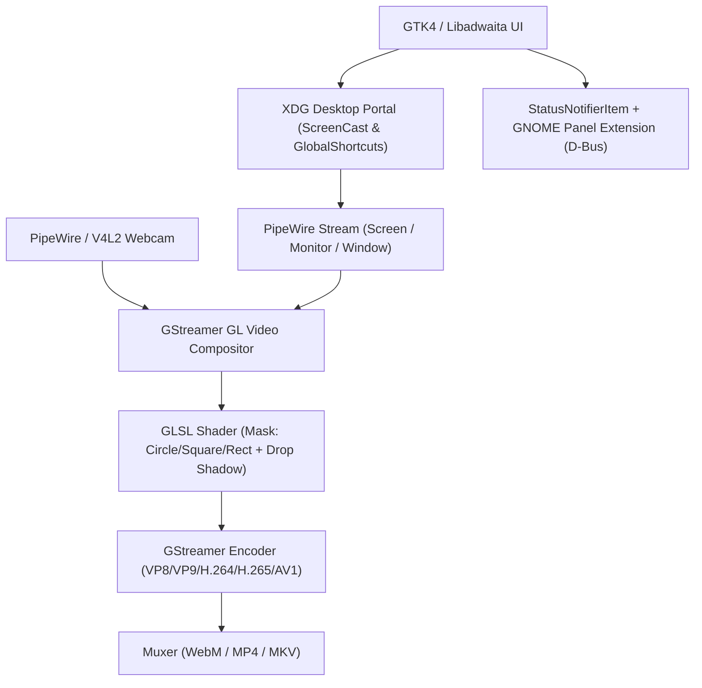

# RecGo Build Plan and Execution Prompts

> [!IMPORTANT]
> **Language Standard Notice:** This build plan uses **ASD-STE100 (Simplified Technical English)**.
> - All instructions use the imperative mood.
> - Each sentence contains one instruction or one technical concept.
> - Active voice is mandatory.
> - Approved technical nouns and verbs are used consistently.

> [!IMPORTANT]
> **Podman Container Compilation Mandate:**
> All compilation, dependency installation, and `cargo` / `meson` commands MUST run inside the Mithrandir Podman development containers (`localhost/dev-fedora:latest` or `localhost/dev-debian:latest`). Do NOT run `cargo` or `meson` directly on the host OS.

---

## 0. Mithrandir Podman Build Environment

### Available Containers
- **Primary Container (Recommended for GTK4 >= 4.14 & Libadwaita >= 1.5):** `localhost/dev-fedora:latest`
- **Secondary Container (Debian Bookworm):** `localhost/dev-debian:latest`
- **Container User:** `devuser` (UID `1000`, GID `1000`, passwordless `sudo` enabled)
- **Container Working Directory:** `/workspace`

### Standard Podman Build Command Template
Mount `/home/antonio/Projects/RecGo` to `/workspace` with `:Z` and `--userns=keep-id`:

```bash
podman run --rm \
  --userns=keep-id \
  -v /home/antonio/Projects/RecGo:/workspace:Z \
  -w /workspace \
  localhost/dev-fedora:latest \
  bash -c "sudo dnf install -y gstreamer1-devel gstreamer1-plugins-base-devel gstreamer1-plugins-bad-free-devel pipewire-devel && cargo check"
```

*(Note: When running Podman from an AI agent tool that uses a sandbox, execute `podman` outside the sandbox (`BypassSandbox: true`) because rootless Podman requires access to `/run/user/1000` and subuid/newuidmap).*

---

## 1. System Architecture and Technical Stack

**RecGo** is a screen and camera recording application for the GNOME desktop.



### Technical Specifications
1. **Language:** Rust (2021 Edition) with `gtk4-rs` and `libadwaita-rs`.
2. **Build System:** Meson and Cargo executed inside Podman (`localhost/dev-fedora:latest`).
3. **Display Capture:** `ashpd` (XDG Desktop Portal `org.freedesktop.portal.ScreenCast`). This provides full screen capture, single monitor selection, and single window capture on Wayland.
4. **Webcam Capture:** PipeWire camera portal (`org.freedesktop.portal.Camera`) or `v4l2src` / `pipewiresrc` via GStreamer.
5. **Compositing & Shapes:** GStreamer OpenGL (`glvideomixer`, `glshader`) to composite screen and webcam feeds, move the webcam overlay (`xpos`, `ypos`), apply geometric masks (Rectangle, Square, Circle), and render a soft drop shadow.
6. **Encoding:**
   - **GNOME Default Formats:** WebM (`vp8enc`, `vp9enc`) and MP4 (`x264enc`, `openh264enc`).
   - **Hardware Accelerated & Next-Gen Formats:** H.264, H.265 (HEVC), and AV1 via VA-API (`vah264enc`, `vah265enc`, `vaav1enc`), NVENC (`nvh264enc`, `nvh265enc`, `nvav1enc`), or software fallback (`x265enc`, `svtav1enc`).
7. **GNOME Panel & Shortcuts:**
   - **Panel Integration:** D-Bus control service (`io.github.antonio.RecGo.Control`) + `org.kde.StatusNotifierItem` (supported by GNOME AppIndicator) + a companion GNOME Shell Extension in `extension/` for native `PanelMenu.Button` support.
   - **Global Shortcuts:** `org.freedesktop.portal.GlobalShortcuts` via `ashpd` (with GSettings keybinding fallback).

---

## 2. Target Directory Structure

```text
/home/antonio/Projects/RecGo/
├── Cargo.toml
├── meson.build
├── build-in-podman.sh
├── BUILD_PLAN.md
├── data/
│   ├── io.github.antonio.RecGo.desktop.in
│   ├── io.github.antonio.RecGo.gschema.xml
│   └── icons/
├── extension/
│   ├── metadata.json
│   └── extension.js
└── src/
    ├── main.rs
    ├── application.rs
    ├── config.rs
    ├── window.rs
    ├── portal/
    │   ├── mod.rs
    │   ├── screencast.rs
    │   └── shortcuts.rs
    ├── pipeline/
    │   ├── mod.rs
    │   ├── codecs.rs
    │   ├── compositor.rs
    │   └── shaders.rs
    ├── tray/
    │   └── mod.rs
    └── ui/
        ├── mod.rs
        ├── preview.rs
        └── preferences.rs
```

---

## 3. ASD-STE100 Prompts for Gemini 3.8 Flash Medium

Send each prompt below to **Gemini 3.8 Flash Medium** in order. Wait for each phase to finish and compile inside the Podman container before you send the next prompt.

---

### Phase 1: Project Skeleton, Podman Build Script, and GTK4/Libadwaita Window (HIG Compliant)

```text
SYSTEM INSTRUCTION:
You are a Rust and GTK4/Libadwaita developer. Follow ASD-STE100 rules in your code comments and documentation. Write complete, compilable code. Do not use placeholders. Execute all compilation commands inside the Mithrandir Podman container `localhost/dev-fedora:latest`.

TASK:
Create the base project and Podman build script in `/home/antonio/Projects/RecGo`.

INSTRUCTIONS:
1. Create `/home/antonio/Projects/RecGo/Cargo.toml`.
2. Add these dependencies to `Cargo.toml`:
   - `gtk = { version = "0.9", package = "gtk4", features = ["v4_14"] }`
   - `adw = { version = "0.7", package = "libadwaita", features = ["v1_5"] }`
   - `gst = { version = "0.23", package = "gstreamer" }`
   - `gst-video = { version = "0.23", package = "gstreamer-video" }`
   - `gst-gl = { version = "0.23", package = "gstreamer-gl" }`
   - `gst-pbutils = { version = "0.23", package = "gstreamer-pbutils" }`
   - `ashpd = { version = "0.9", features = ["tokio", "gtk4"] }`
   - `tokio = { version = "1", features = ["full"] }`
   - `zbus = "4"`
   - `serde = { version = "1", features = ["derive"] }`
   - `serde_json = "1"`
3. Create `/home/antonio/Projects/RecGo/build-in-podman.sh`:
   - Run `podman run --rm --userns=keep-id -v /home/antonio/Projects/RecGo:/workspace:Z -w /workspace localhost/dev-fedora:latest`.
   - Inside the container, install GStreamer development headers (`gstreamer1-devel`, `gstreamer1-plugins-base-devel`, `gstreamer1-plugins-bad-free-devel`, `pipewire-devel`) and run `cargo "$@"`.
4. Create `data/io.github.antonio.RecGo.gschema.xml`. Define keys for:
   - `video-codec` (string: "vp8", "vp9", "h264", "h265", "av1")
   - `container-format` (string: "webm", "mp4", "mkv")
   - `layout-preset` (string: "desktop-pip", "side-by-side", "screen-only", "camera-only")
   - `webcam-shape` (string: "rectangle", "square", "circle")
   - `webcam-pos-x` (double: 0.0 to 1.0)
   - `webcam-pos-y` (double: 0.0 to 1.0)
   - `webcam-scale` (double: 0.1 to 0.5)
   - `shortcut-start-stop` (string)
   - `shortcut-pause` (string)
5. Create `src/main.rs`, `src/application.rs`, and `src/window.rs`.
6. Build the main window with `adw::ApplicationWindow` and `adw::ToolbarView` to follow the GNOME Human Interface Guidelines (HIG).
7. Add an `adw::HeaderBar` with a `adw::ViewSwitcher` and a primary menu button.
8. Add three main controls in a bottom action bar:
   - A "Record" button with the `.suggested-action` and `.pill` CSS classes.
   - A "Pause" toggle button.
   - A "Stop" button with the `.destructive-action` and `.pill` CSS classes.
9. Verify that the code compiles cleanly by running `/home/antonio/Projects/RecGo/build-in-podman.sh check` (run with `BypassSandbox: true` so Podman can access `/run`).
```

---

### Phase 2: Screen, Monitor, and Window Capture via XDG Desktop Portal

```text
SYSTEM INSTRUCTION:
You are a Rust and GTK4/Libadwaita developer. Follow ASD-STE100 rules. Write complete code without placeholders. Run all builds inside the Mithrandir Podman container.

TASK:
Implement screen, multi-monitor, and window capture in `/home/antonio/Projects/RecGo/src/portal/`.

INSTRUCTIONS:
1. Create `src/portal/mod.rs` and `src/portal/screencast.rs`.
2. Use `ashpd::desktop::screencast::Screencast` to communicate with the GNOME XDG Desktop Portal.
3. Implement a function `start_screencast_session(source_type: SourceType, cursor_mode: CursorMode)`.
4. Support three capture modes in the UI selector:
   - Full Screen / Specific Monitor (`SourceType::Monitor`). Allow the user to select from connected monitors.
   - Application Window (`SourceType::Window`).
   - Virtual Display (`SourceType::Virtual`).
5. Set `PersistMode::ExplicitlyRevoked` so the user can reuse the monitor selection across recordings.
6. Extract the PipeWire file descriptor (`OwnedFd`) and the PipeWire `node_id` from the portal response.
7. Return a struct `CaptureStream { fd: OwnedFd, node_id: u32, width: i32, height: i32 }` to pass to the GStreamer pipeline.
8. Connect the UI capture source selector in `src/window.rs` to this portal module.
9. Run `/home/antonio/Projects/RecGo/build-in-podman.sh check` to verify compilation inside the container.
```

---

### Phase 3: Webcam Overlay, Presets, Drag-to-Move, Shapes, and Drop Shadow

```text
SYSTEM INSTRUCTION:
You are a GStreamer and OpenGL developer using Rust. Follow ASD-STE100 rules. Write complete code without placeholders. Run all builds inside the Mithrandir Podman container.

TASK:
Create the video compositor pipeline with webcam layout presets, interactive drag positioning, geometric shapes, and drop shadows.

INSTRUCTIONS:
1. Create `src/pipeline/mod.rs`, `src/pipeline/compositor.rs`, and `src/pipeline/shaders.rs`.
2. In `src/pipeline/shaders.rs`, write a GLSL fragment shader for `glshader` that processes the webcam video stream:
   - Input uniforms: `u_shape` (0 = rectangle, 1 = square, 2 = circle), `u_corner_radius` (float), `u_shadow_blur` (float), `u_shadow_offset` (vec2), `u_aspect_ratio` (float).
   - Calculate the Signed Distance Field (SDF) for the selected shape:
     * For Circle: crop to 1:1 aspect ratio and compute distance from center `length(uv - 0.5) - radius`.
     * For Square: crop to 1:1 aspect ratio and compute rounded box SDF.
     * For Rectangle: keep native camera aspect ratio (e.g. 16:9) and compute rounded box SDF.
   - Render a dark translucent drop shadow (`rgba(0.0, 0.0, 0.0, 0.55)`) with smoothstep falloff around the outer edge of the SDF mask so the webcam pops out from the screen recording.
   - Composite the webcam texture inside the mask with anti-aliased edges (`smoothstep`).
3. In `src/pipeline/compositor.rs`, build a GStreamer `glvideomixer` pipeline:
   - Pad 0: Screen/Window PipeWire stream (`pipewiresrc fd=... path=...`).
   - Pad 1: Webcam stream (`pipewiresrc` or `v4l2src`) filtered through `glupload ! glcolorconvert ! glshader ! glcolorconvert`.
4. Implement two layout presets:
   - `DesktopPiP`: Screen stream fills 100% of the canvas. Webcam stream sits on top at `(xpos, ypos)` with configurable width/height.
   - `SideBySide`: Canvas splits 50/50 horizontally. Left pad shows the screen stream; right pad shows the webcam stream.
5. Create `src/ui/preview.rs` and attach a `gtk::GestureDrag` controller:
   - When the user drags the webcam enclosure in the preview, calculate the normalized `(x, y)` coordinates.
   - Update the `xpos` and `ypos` properties on the `glvideomixer` webcam pad in real time.
6. Run `/home/antonio/Projects/RecGo/build-in-podman.sh check` to verify compilation inside the container.
```

---

### Phase 4: Hardware-Accelerated Codecs (GNOME Defaults + H.265 + AV1)

```text
SYSTEM INSTRUCTION:
You are a GStreamer developer using Rust. Follow ASD-STE100 rules. Write complete code without placeholders. Run all builds inside the Mithrandir Podman container.

TASK:
Implement codec discovery and encoding in `/home/antonio/Projects/RecGo/src/pipeline/codecs.rs`.

INSTRUCTIONS:
1. Create `src/pipeline/codecs.rs`.
2. Query `gst::ElementFactory::find` at startup to detect available hardware and software encoders.
3. Implement support for these recording formats:
   - **WebM (VP8 / VP9):** Match the integrated GNOME Shell screen recorder defaults (`vp8enc` / `vp9enc` + `webmmux`).
   - **MP4 / MKV (H.264):** Use `vah264enc` (VA-API) or `nvh264enc` (NVENC) if present; fallback to `x264enc` or `openh264enc`.
   - **MP4 / MKV (H.265 / HEVC):** Probe for `vah265enc` or `nvh265enc` on capable hardware; fallback to `x265enc` if selected.
   - **WebM / MP4 / MKV (AV1):** Probe for `vaav1enc` or `nvav1enc` on capable hardware; fallback to `svtav1enc`.
4. Implement a function `get_supported_codecs() -> Vec<CodecInfo>` that returns each codec and marks whether hardware acceleration is available on the host GPU.
5. Implement state transitions on the pipeline:
   - `start()`: Set pipeline to `gst::State::Playing`.
   - `pause()`: Set pipeline to `gst::State::Paused` so the output file pauses cleanly without splitting.
   - `resume()`: Set pipeline back to `gst::State::Playing`.
   - `stop()`: Send `gst::event::Eos::new()` to the pipeline, wait for the `EOS` bus message, and set state to `gst::State::Null`.
6. Create `src/ui/preferences.rs` using `adw::PreferencesDialog`, `adw::PreferencesPage`, `adw::PreferencesGroup`, and `adw::ComboRow` to let the user select the codec, container, framerate (30/60 FPS), and audio sources.
7. Run `/home/antonio/Projects/RecGo/build-in-podman.sh check` to verify compilation inside the container.
```

---

### Phase 5: GNOME Panel Integration and Global Shortcuts

```text
SYSTEM INSTRUCTION:
You are a GNOME and Rust developer. Follow ASD-STE100 rules. Write complete code without placeholders. Run all builds inside the Mithrandir Podman container.

TASK:
Add GNOME top panel integration and global keyboard shortcuts to control recording (Start, Pause, Stop).

INSTRUCTIONS:
1. Create `src/portal/shortcuts.rs`:
   - Use `ashpd::desktop::global_shortcuts::GlobalShortcuts` to register three shortcuts with GNOME:
     * `start-stop-recording` ("Start or Stop Recording", default trigger `<Control><Alt><Shift>R`)
     * `pause-resume-recording` ("Pause or Resume Recording", default trigger `<Control><Alt><Shift>P`)
     * `cycle-webcam-shape` ("Change Webcam Shape", default trigger `<Control><Alt><Shift>C`)
   - Listen to the `Activated` signal stream and trigger the recording state machine in `src/application.rs`.
2. Create `src/tray/mod.rs`:
   - Expose a D-Bus interface at `/io/github/antonio/RecGo` (`io.github.antonio.RecGo.Control`) using `zbus`.
   - Expose methods: `Start()`, `Pause()`, `Stop()`, `ShowWindow()`.
   - Expose properties: `State` ("idle", "recording", "paused") and `ElapsedSeconds` (u64).
   - Also implement the `org.kde.StatusNotifierItem` tray icon specification so systems with the GNOME AppIndicator extension display a panel icon immediately.
3. Create the native GNOME Shell Extension in `/home/antonio/Projects/RecGo/extension/`:
   - Create `extension/metadata.json` for GNOME Shell 45, 46, and 47.
   - Create `extension/extension.js` using ESModules (`import * as Main from 'resource:///org/gnome/shell/ui/main.js'`).
   - Add a `PanelMenu.Button` to the GNOME top panel with a recording status indicator dot, an elapsed time label, and popup menu items for "Start Recording", "Pause / Resume", "Stop Recording", and "Open RecGo".
   - Connect the extension to the `io.github.antonio.RecGo.Control` D-Bus proxy.
4. Verify the full workspace inside the Mithrandir Podman container with `/home/antonio/Projects/RecGo/build-in-podman.sh build`.
```
