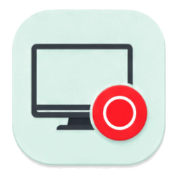
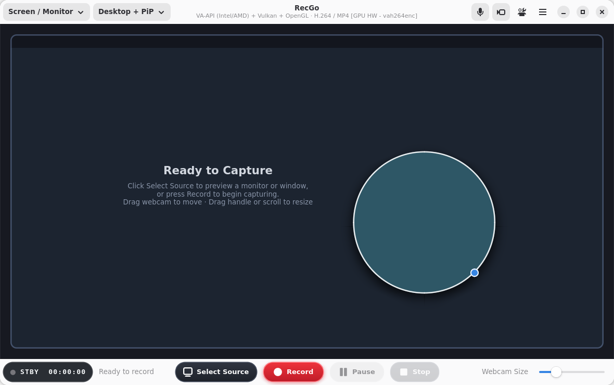
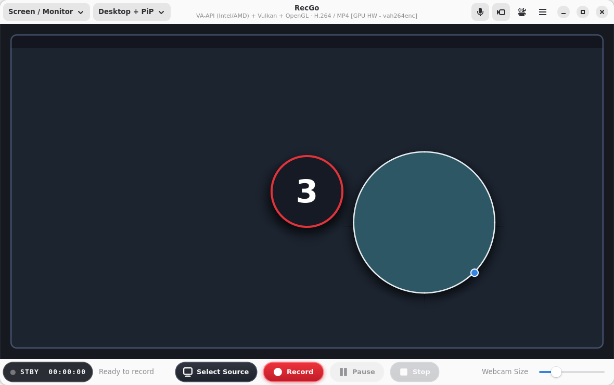
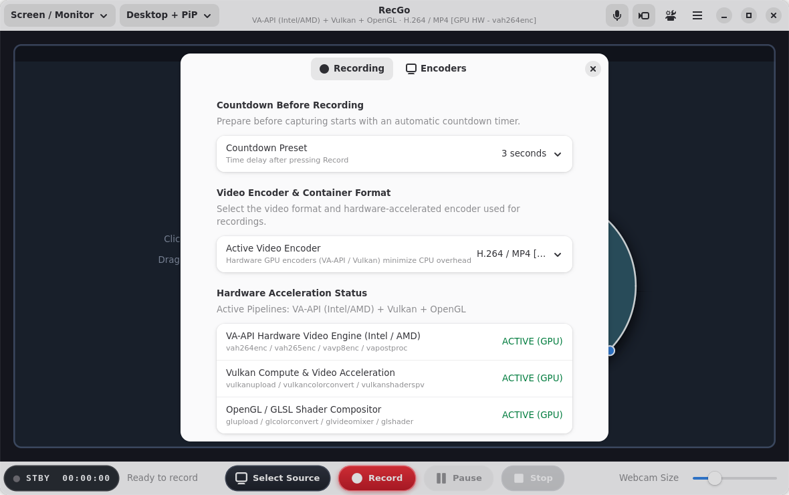

# RecGo

<p align="center">
  
</p>

<p align="center">
  <b>Modern, High-Performance GPU-Accelerated Screen and Webcam Recorder for the GNOME Desktop.</b>
</p>

<p align="center">
  <a href="https://github.com/Antux912012/RecGo/releases"></a>
  <a href="https://www.gnu.org/licenses/gpl-3.0"></a>
  <a href="https://www.gtk.org/"></a>
  <a href="https://gnome.pages.gitlab.gnome.org/libadwaita/"></a>
  <a href="https://github.com/Antux912012/RecGo"></a>
</p>

---

## Overview

**RecGo** is a native, HIG-compliant Wayland screen, application window, and webcam recorder tailored for GNOME. Built with Rust, GTK4, Libadwaita, GStreamer, and PipeWire, RecGo provides high framerate screen recording with near-zero CPU load using full GPU hardware acceleration (VA-API Intel/AMD, Vulkan Video, and OpenGL).

---

## Screenshots

| Studio Main View | Countdown Overlay |
| :---: | :---: |
|  |  |

| Preferences & Hardware Encoders |
| :---: |
|  |

---

## Key Features

### 🎬 Camera Controls & Viewfinder OSD
- **Viewfinder Status OSD Badge:** Real-time recording state indicators (`STBY`, `REC 00:00:00`, `PAUSE 00:00:00`) with high-contrast color-coded indicators.
- **Camera-Style Shutter Controls:**
  - **Record Button:** High-visibility camera shutter button with red record dot.
  - **Pause Toggle:** Camera pause control (❚❚) with amber pause indicator.
  - **Stop Button:** Dark metallic camera stop button (◼) with automatic pipeline finalization.
- **Symbolic Desktop Preview Trigger:** Bottom Action Bar button (`video-display-symbolic`) allowing quick screen or window selection and live desktop preview.

### ⚙️ Preferences & Video Codec Selection
- **Dedicated Preferences Menu:** Easily accessible from the top HeaderBar (`emblem-system-symbolic`).
- **Dynamic Encoder Selection:** Choose from detected GPU hardware encoders and software CPU encoders:
  - **H.264 / AVC (MP4):** Intel Quick Sync & AMD VA-API hardware acceleration, or x264 software fallback.
  - **H.265 / HEVC (MP4):** High-efficiency hardware compression via VA-API or Vulkan Video.
  - **VP8 / VP9 (WebM):** Native open web formats with hardware acceleration.
  - **AV1 (MKV):** Next-generation AV1 video encoding via VA-API / Vulkan.
- **Real-Time Hardware Diagnostics:** Built-in hardware engine verification for VA-API, Vulkan Compute, and OpenGL compositors.

### 🎥 Draggable & Resizable Webcam Overlay
- **Direct Interactive Manipulation:** Freely drag the camera feed anywhere on the preview canvas.
- **Flexible Sizing:** Resize through the blue corner handle, mouse scroll wheel, or the bottom-bar slider.
- **Geometric Enclosure Shapes:** Choose between **Circle**, **Square**, and **Rectangle** webcam frames with dynamic drop shadows.

### 📐 Layout Presets
- **Desktop + Webcam PiP:** Picture-in-picture recording with customizable webcam position and scale.
- **Side by Side (50/50 Split):** Split-screen recording ideal for presentations and tutorials.
- **Screen Only:** Record desktop displays or specific application windows.
- **Camera Only:** Direct webcam recording without portal screen prompts.

### ⚡ Hardware Acceleration & Pipelines
- **Direct Zero-Copy GPU Rendering:** Leverages GTK4 GSK GPU snapshotting and GStreamer hardware postprocessing.
- **PipeWire & XDG Desktop Portal:** Fully sandboxed Wayland desktop capture using `org.freedesktop.portal.ScreenCast`.
- **Fast-Start MP4 Finalization:** Automatic `moov` atom header positioning and stream EOS synchronization for instant video playback.

### ℹ️ HIG-Compliant About Dialog
- Accessible via the top HeaderBar (`help-about-symbolic`).
- Direct link to the [GitHub Repository](https://github.com/Antux912012/RecGo).
- Issue tracker links and licensing under **GNU General Public License v3.0 (GPLv3)**.

---

## Installation & Packaging

### Standalone Flatpak (Recommended)

RecGo is packaged as a standalone Flatpak bundle:

```bash
# Install the Flatpak bundle locally
flatpak install --user --reinstall RecGo.flatpak

# Run RecGo
flatpak run io.github.antonio.RecGo
```

---

## Building from Source

### Containerized Build with Podman (Recommended)

RecGo includes an automated Podman build harness to guarantee clean, reproducible builds without polluting your host environment:

```bash
# Clone the repository
git clone https://github.com/Antux912012/RecGo.git
cd RecGo

# Verify compilation inside the container
./build-in-podman.sh check

# Build release binary inside the container
./build-in-podman.sh build --release

# Package into a standalone Flatpak bundle
./package-flatpak.sh
```

---

## Project Structure

```
RecGo/
├── data/
│   ├── icons/                          # Multi-resolution icons and SVG
│   ├── io.github.antonio.RecGo.desktop.in # Desktop entry file
│   ├── io.github.antonio.RecGo.gschema.xml # GSettings schema
│   └── io.github.antonio.RecGo.metainfo.xml # AppStream metadata
├── src/
│   ├── pipeline/
│   │   ├── codecs.rs                   # Hardware encoder detection (VA-API/Vulkan/NVENC)
│   │   └── compositor.rs               # GStreamer pipelines & live capture
│   ├── portal/
│   │   └── screencast.rs               # PipeWire & XDG Desktop Portal integration
│   ├── ui/
│   │   ├── preferences.rs              # Preferences dialog & encoder settings
│   │   └── preview.rs                  # Interactive GTK4 preview canvas & shapes
│   ├── main.rs                         # Application entrypoint
│   └── window.rs                       # Main window, HeaderBar, and Action Bar
├── build-in-podman.sh                  # Containerized build script
├── package-flatpak.sh                  # Flatpak bundle packager
├── LICENSE                             # GNU General Public License v3.0
└── README.md
```

---

## License

This project is licensed under the **GNU General Public License v3.0 (GPL-3.0-or-later)**.
See the [LICENSE](LICENSE) file for the full license text.

Copyright (C) 2026 Antonio.
