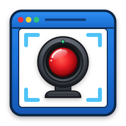
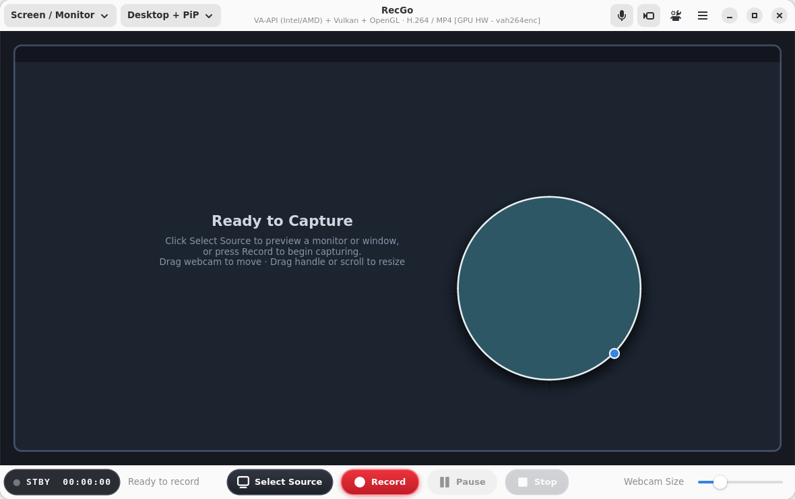
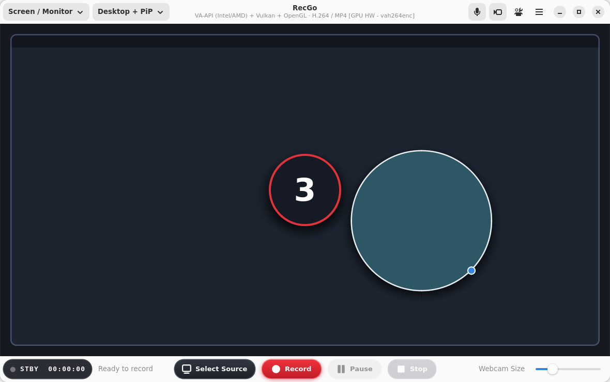
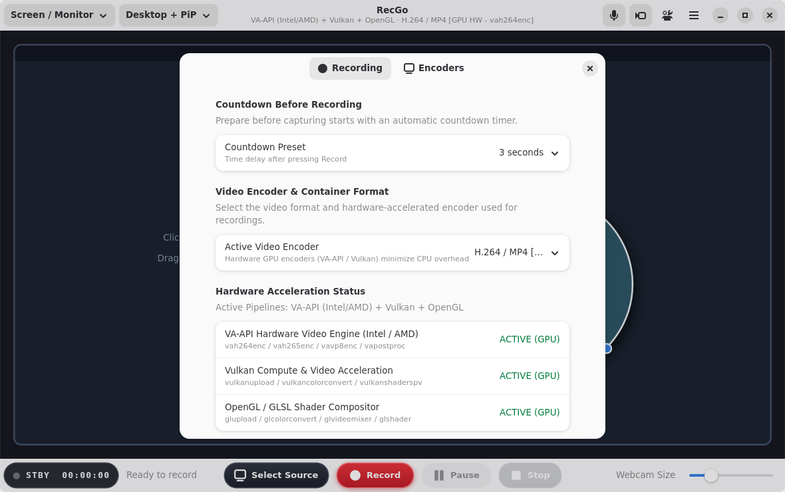

# RecGo

<p align="center">
  
</p>

<p align="center">
  <b>Modern, High-Performance GPU-Accelerated Screen and Webcam Recorder for the GNOME Desktop.</b>
</p>

<p align="center">
  <a href="https://github.com/Antux912012/RecGo/releases"></a>
  <a href="https://www.gnu.org/licenses/gpl-3.0"></a>
  <a href="https://www.gtk.org/"></a>
  <a href="https://gnome.pages.gitlab.gnome.org/libadwaita/"></a>
  <a href="https://github.com/Antux912012/RecGo"></a>
</p>

---

## Overview

**RecGo** is a native, HIG-compliant Wayland screen, application window, and multi-webcam recorder tailored for GNOME 51. Built with **Vala, C, Meson, GTK4, Libadwaita, GStreamer, and PipeWire**, RecGo provides high-framerate screen recording with minimal CPU overhead using GPU hardware acceleration (VA-API Intel/AMD, Vulkan Video, and OpenGL `glvideomixer`).

---

## Screenshots

| Studio Main View | Countdown Overlay |
| :---: | :---: |
|  |  |

| Preferences & Hardware Encoders |
| :---: |
|  |

---

## Key Features

### 🎬 Camera Controls & Viewfinder OSD
- **Viewfinder Status OSD Badge:** Real-time recording state indicators (`STBY`, `REC 00:00:00`, `PAUSE 00:00:00`) with high-contrast color-coded indicators.
- **Camera-Style Shutter Controls:**
  - **Record Button:** High-visibility camera shutter button with red record dot.
  - **Pause Toggle:** Camera pause control (❚❚) with amber pause indicator.
  - **Stop Button:** Dark metallic camera stop button (◼) with automatic pipeline finalization.
- **Symbolic Desktop Preview Trigger:** Bottom Action Bar button (`video-display-symbolic`) allowing quick screen or window selection and live desktop preview.

### ⚙️ Preferences & Video Codec Selection
- **Dedicated Preferences Menu:** Easily accessible from the top HeaderBar (`emblem-system-symbolic`).
- **Dynamic Encoder Selection:** Choose from detected GPU hardware encoders and software CPU encoders:
  - **H.264 / AVC (MP4):** Intel Quick Sync & AMD VA-API hardware acceleration, or x264 software fallback.
  - **H.265 / HEVC (MP4):** High-efficiency hardware compression via VA-API or Vulkan Video.
  - **VP8 / VP9 (WebM):** Native open web formats with hardware acceleration.
  - **AV1 (MKV):** Next-generation AV1 video encoding via VA-API / Vulkan.
- **Real-Time Hardware Diagnostics:** Built-in hardware engine verification for VA-API, Vulkan Compute, and OpenGL compositors.

### 🎥 Draggable, Resizable & Masked Webcam Overlay
- **Direct Interactive Manipulation:** Freely drag the camera feed anywhere on the preview canvas.
- **Flexible Sizing:** Resize through the blue corner handle, mouse scroll wheel, or the bottom-bar slider.
- **Baked Geometric Enclosure Masks (`recgo-video-fx.c`):** Choose between **Circle**, **Rounded Square**, and **Rounded Rectangle** frames with configurable white borders and drop shadows—composited identically in both live preview and recorded video on GPU (`glvideomixer`) and CPU (`compositor`) pipelines.
- **Webcam Image FX Suite:** Live presets (*Natural*, *Low-Light Boost*, *Studio Warm*, *Crisp & Vivid*, *Black & White*), horizontal mirror, auto low-light enhance, digital zoom, brightness, contrast, gamma/exposure, color warmth, saturation, sharpness, and temporal noise reduction.

### 🔋 Older Hardware Reliability & Sandboxed Settings
- **Performance Profiles:** Choose *Older Hardware / Power Saver (720p)*, *Balanced*, or *High Quality* with selectable `24` / `30` / `60` FPS targets and automatic GPU-to-CPU encoder fallback.
- **Flatpak Schema Resilience (`SafeSettings`):** Graceful fallback to default schema values when launched inside Flatpak sandboxes with older compiled GSettings schemas.

### 🖥️ Multi-Screen, Cam + Window & Multi-Microphone
- **Multi-Screen Recording:** Select multiple monitors via XDG Desktop Portal (`multiple: true`) and composite them automatically in a clean grid/row with live multi-display preview.
- **Cam + Window App Recording:** Record any application window with your webcam overlay (`Desktop + PiP` or `Side by Side`), with aspect-ratio preservation (`add-borders` / dynamic GL caps probe) so window resizes never stretch or distort.
- **Multi-Microphone Mixer & Live Mute:** Mix multiple microphones via GStreamer `audiomixer` (`48 kHz` synchronized) with live mute/unmute during active recordings.

### ✂️ Simplified In-App Edit Mode (Kdenlive-Inspired)
- Switch between **Record** and **Edit** in the HeaderBar (or click **Edit** directly from the saved-recording toast).
- **Project Bin, Preview Monitor & V1/A1 Timeline:** Scrub the playhead, set **In / Out** trim points, mark **Split** points, and export trimmed videos using your active hardware/software encoder.

### 🎨 Bundled Papirus Symbolic Icons
- All symbolic UI icons are bundled in GResource (`/io/github/Antux912012/RecGo/icons/papirus`) so the interface renders consistently regardless of the host GNOME icon theme.

### 📐 Layout Presets
- **Desktop + Webcam PiP:** Picture-in-picture recording with customizable webcam position and scale.
- **Side by Side (50/50 Split):** Split-screen recording ideal for presentations and tutorials.
- **Screen Only:** Record desktop displays or specific application windows.
- **Camera Only:** Direct webcam recording without portal screen prompts.

### ⚡ Hardware Acceleration & Pipelines
- **Direct Zero-Copy GPU Rendering:** Leverages GTK4 GSK GPU snapshotting and GStreamer hardware postprocessing.
- **PipeWire & XDG Desktop Portal:** Fully sandboxed Wayland desktop capture using `org.freedesktop.portal.ScreenCast`.
- **Fragmented MP4 Finalization:** Streamable fragmented MP4 (`fragment-duration=1000`) and EOS synchronization for reliable video playback.

### ℹ️ HIG-Compliant About Dialog
- Accessible via the top HeaderBar (`help-about-symbolic`).
- Direct link to the [GitHub Repository](https://github.com/Antux912012/RecGo).
- Issue tracker links and licensing under **GNU General Public License v3.0 (GPLv3)**.

---

## Installation & Packaging

### Standalone Flatpak, Debian, Fedora RPM & AUR

RecGo is distributed via [GitHub Releases](https://github.com/Antux912012/RecGo/releases) as `.flatpak`, `.deb`, `.rpm`, and AUR `PKGBUILD`:

```bash
# Install the Flatpak bundle locally
flatpak install --user --reinstall RecGo-0.3.1-x86_64.flatpak

# Run RecGo
flatpak run io.github.Antux912012.RecGo
```

See [CHANGELOG.md](CHANGELOG.md) for the full release history.

---

## Building from Source

### Containerized Build with Podman (Recommended)

RecGo includes an automated Podman build harness to guarantee clean, reproducible builds without polluting your host environment:

```bash
# Clone the repository
git clone https://github.com/Antux912012/RecGo.git
cd RecGo

# Setup and build inside the container
./build-in-podman.sh setup
./build-in-podman.sh build

# Run unit tests inside the container
./build-in-podman.sh test

# Package into a standalone Flatpak bundle
./package-flatpak.sh
```

---

## Project Structure

```
RecGo/
├── data/
│   ├── icons/                          # Multi-resolution icons and SVG
│   ├── io.github.Antux912012.RecGo.desktop.in # Desktop entry file
│   ├── io.github.Antux912012.RecGo.gschema.xml # GSettings schema
│   ├── io.github.Antux912012.RecGo.metainfo.xml # AppStream metadata
│   ├── recgo.gresource.xml             # Bundled CSS and symbolic icons
│   └── style.css                       # Application stylesheet
├── src/
│   ├── gst/
│   │   ├── recgo-codecs.c/.h           # Hardware encoder detection (VA-API/Vulkan/NVENC)
│   │   ├── recgo-devices.c/.h          # PipeWire / V4L2 / PulseAudio device manager
│   │   ├── recgo-editor.c/.h           # GStreamer non-blocking trim/export pipeline
│   │   ├── recgo-preview.c/.h          # Live GStreamer -> GdkTexture preview bridge
│   │   ├── recgo-recorder.c/.h         # GStreamer multi-input compositing & recording
│   │   ├── recgo-video-fx.c/.h         # Webcam mask & image FX pad probe
│   │   └── recgo-gst.vapi              # Vala bindings for recgo-gst C core
│   ├── application.vala                # Adw.Application, D-Bus control & shortcuts
│   ├── editor-view.vala                # Kdenlive-inspired Edit Mode view & transport
│   ├── main.vala                       # Application entrypoint
│   ├── portal.vala                     # XDG Desktop Portal ScreenCast & GlobalShortcuts
│   ├── preferences-dialog.vala         # Preferences dialog & device selection
│   ├── preview-widget.vala             # Interactive GTK4 preview canvas & shapes
│   ├── safe-settings.vala              # Resilient GSettings wrapper
│   ├── timeline-widget.vala            # V1/A1 timeline with playhead, trim & split
│   └── window.vala                     # Main window, HeaderBar, and Action Bar
├── tests/
│   └── test-gst.c                      # GStreamer core unit tests
├── build-in-podman.sh                  # Containerized build script
├── package-flatpak.sh                  # Flatpak bundle packager
├── LICENSE                             # GNU General Public License v3.0
└── README.md
```

---

## License

This project is licensed under the **GNU General Public License v3.0 (GPL-3.0-or-later)**.
See the [LICENSE](LICENSE) file for the full license text.

Copyright (C) 2026 Antonio.
